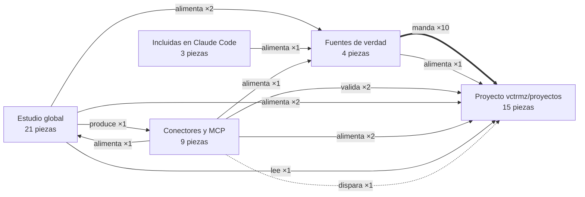
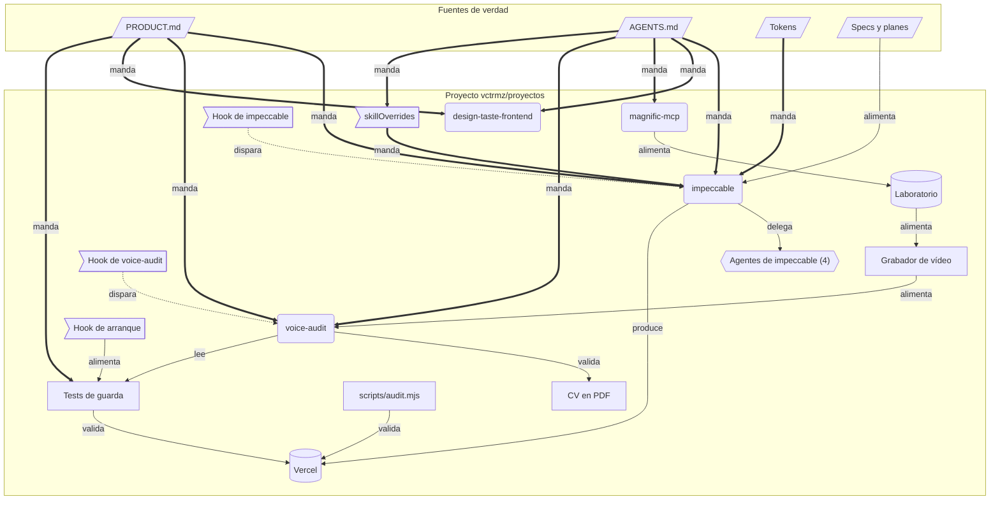
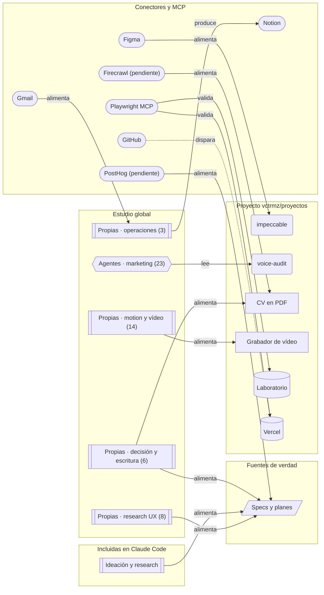
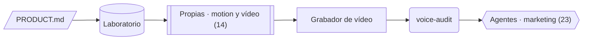
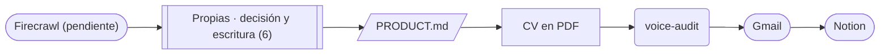
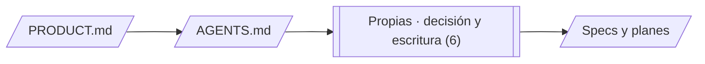
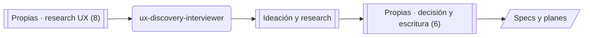
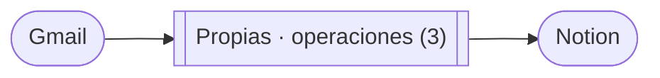

# Mapa del estudio

<!-- Generado por mapa/generar.mjs desde mapa/grafo.json. No editar a mano: edita el JSON y vuelve a generar. -->

Todo lo que usa Claude en el estudio y en el portfolio, como un grafo: qué decide sobre qué, quién delega en quién y qué valida cada resultado. Versión 2026-10-22b.

Las fuentes de verdad mandan (flecha gruesa), las skills y agentes trabajan, y los scripts, los tests y el navegador validan antes de que algo llegue a Vercel. Las flechas de puntos son automáticas.

## Leyenda

| Forma | Tipo |
| --- | --- |
| `/documento/` | fuente de verdad |
| `(skill)` | skill suelta |
| `[[grupo]]` | grupo de skills |
| `{{agente}}` | agente o grupo de agentes |
| `>hook]` | hook |
| `[script]` | script o test |
| `[(superficie)]` | web, lab o despliegue |
| `([conector])` | conector o MCP |

| Relación | Significa |
| --- | --- |
| `manda` | decide sobre, gana en caso de conflicto |
| `lee` | la usa como contexto o restricción |
| `delega` | le pasa una parte del trabajo |
| `dispara` | la lanza sola, sin pedirla |
| `valida` | comprueba el resultado |
| `produce` | genera o actualiza |
| `alimenta` | le da material de entrada |

## Vista de capas

Cada caja es una capa; cada flecha suma las relaciones que van de una a otra.

## Núcleo: el portfolio

Fuentes de verdad y piezas del repo proyectos. Es donde se decide qué llega a producción.

## Estudio y conectores

Lo que entra al núcleo desde el estudio global, los conectores y las skills incluidas.

## Flujos de trabajo

Cada flujo es un camino por el grafo. Es la secuencia que conviene seguir, y la fila «Automatizar» es el siguiente paso para que lo haga solo.

### Caso nuevo o cambio en un caso

**Cuándo:** Añadir o reescribir un caso, una sección de la web o un componente público.

```mermaid
flowchart LR
  product_md[/"PRODUCT.md"/]
  specs[/"Specs y planes"/]
  impeccable("impeccable")
  hook_impeccable>"Hook de impeccable"]
  hook_voice_audit>"Hook de voice-audit"]
  voice_audit("voice-audit")
  tests["Tests de guarda"]
  agentes_impeccable{{"Agentes de impeccable (4)"}}
  vercel[("Vercel")]
  playwright_mcp(["Playwright MCP"])
  audit_script["scripts/audit.mjs"]
  product_md --> specs
  specs --> impeccable
  impeccable --> hook_impeccable
  hook_impeccable --> hook_voice_audit
  hook_voice_audit --> voice_audit
  voice_audit --> tests
  tests --> agentes_impeccable
  agentes_impeccable --> vercel
  vercel --> playwright_mcp
  playwright_mcp --> audit_script
```

**Automatizar:** Hecho: npm ci al arrancar en la nube y voice-audit tras editar copy. Falta: revisión de previews con Playwright cuando la red permita *.vercel.app.

### Vídeo para LinkedIn

**Cuándo:** Contar una decisión de un caso en 10 segundos que hagan clic hacia la web.

**Automatizar:** Generalizar el grabador a cualquier página con draw(t) determinista (estados de UI reales, patrón verbove).

### Candidatura y networking

**Cuándo:** Una oferta Senior o Lead que encaja, o un contacto al que escribir.

**Automatizar:** Skill candidatura que encadene oferta → empresa → CV → mensaje, con el seguimiento en Notion.

### Evaluar un repo o skill externa

**Cuándo:** Alguien comparte un repo, una skill o un conector.

**Automatizar:** Skill evaluar-repo: clon en scratchpad, licencia, contraste con PRODUCT.md y AGENTS.md, veredicto (descartar · referencia · vendorizar con UPSTREAM.md · adaptar) y alta en fuentes.txt.

### Discovery y research UX

**Cuándo:** Validar un problema o una idea de producto antes de diseñar.

**Automatizar:** Plantilla de síntesis en Notion o Claude Docs al cerrar cada entrevista.

### Revisión semanal

**Cuándo:** Una vez por semana.

**Automatizar:** Tarea programada semanal que lance weekly-review-planning y competitor-news-monitor.

## Solapes y quién gana

Cuando dos piezas hacen lo mismo, Claude puede elegir la que no toca. Esta es la regla de cada caso.

| Tema | Piezas | Regla |
| --- | --- | --- |
| Diseño y crítica de UI | impeccable · skillOverrides · ui-craft (4 + 10) · ui-ux-pro-max · apple-design · design-taste-frontend | En proyectos manda impeccable (AGENTS.md), y skillOverrides deja ui-craft, ui-ux-pro-max, design-md y apple-design solo con /nombre allí. Fuera del portfolio, ui-craft. |
| Escritura y copy | voice-audit · Propias · decisión y escritura (6) · Vercel agent-skills | En proyectos, voice-audit (lee PRODUCT.md). Fuera, humanizer o writing-guidelines. |
| Revisión final de diseño | Agentes de impeccable (4) · Agentes · diseño (10) | En proyectos, impeccable-finish-reviewer. design-ui-finish-gate-reviewer fuera. |
| Vídeo | Grabador de vídeo · Propias · motion y vídeo (14) · brag / brag-slim · magnific-mcp | hairline-record: captura determinista de la web. HyperFrames: composición en HTML. brag: lanzamiento de un proyecto. Magnific: generado, nunca como prueba de un caso. |
| Navegador | Playwright MCP · scripts/audit.mjs | MCP para explorar y revisar a mano; audit.mjs para la auditoría repetible que se compara entre versiones. |
| Marcas de referencia | Propias · diseño UI (6) · impeccable | design-md copia el lenguaje de marcas ajenas: nunca en páginas públicas del portfolio, que es prueba de autoría. |

## Automatizaciones pendientes

| # | Qué | Por qué | Con qué |
| --- | --- | --- | --- |
| 1 | Skill evaluar-repo | Es el flujo que más se repite: seis repos evaluados en una semana con los mismos pasos. | skill-creator |
| 2 | Grabador genérico de páginas con draw(t) | El mismo método sirve para Hairline y para vídeos de estados de UI reales. | scripts/hairline-record.mjs |
| 3 | Skill candidatura | Oferta, empresa, CV y mensaje con un solo relato y la voz de PRODUCT.md. | skill-creator + Firecrawl |
| 4 | Tarea programada semanal | Revisión de la semana y vigilancia de empresas objetivo sin acordarse. | tareas programadas |
| 5 | CI en este repo: node mapa/generar.mjs --check | El mapa y el catálogo no se desfasan de las carpetas. | GitHub Actions |

## Inventario

### Fuentes de verdad · deciden antes que cualquier skill

| Pieza | Tipo | Dónde | Cómo se activa | Qué hace |
| --- | --- | --- | --- | --- |
| PRODUCT.md | documento | `proyectos/PRODUCT.md` | lectura | Para quién es la web, posicionamiento, voz, lo que no se publica y un solo relato en web, CV y LinkedIn. |
| AGENTS.md | documento | `proyectos/AGENTS.md (CLAUDE.md lo importa)` | lectura | Next.js 16 rompe convenciones; qué skill manda en cada caso (impeccable primero). |
| Tokens | documento | `proyectos/app/globals.css` | lectura | Única paleta, escala tipográfica y espaciado. test/tokens.test.ts impide hex retirados. |
| Specs y planes | documento | `proyectos/docs/superpowers/` | manual | Flujo spec → plan → código → revisión → tests y auditoría. |

### Proyecto vctrmz/proyectos · .claude/ del repo del portfolio

| Pieza | Tipo | Dónde | Cómo se activa | Qué hace |
| --- | --- | --- | --- | --- |
| impeccable | skill | `proyectos/.claude/skills/impeccable` | auto · /impeccable | Fuente de verdad del diseño de UI: shape, audit, critique, polish, layout, animate… v4.3.1. |
| design-taste-frontend | skill | `proyectos/.claude/skills/design-taste-frontend` | solo /design-taste-frontend | Crítica de dirección visual de páginas públicas, con --keep palette,type. Input, no mandato. |
| magnific-mcp | skill | `proyectos/.claude/skills/magnific-mcp` | auto | Guía del MCP de Magnific (imagen, vídeo, audio, 3D). Nunca sustituye material real de un caso. |
| voice-audit | skill | `proyectos/.claude/skills/voice-audit` | auto · /voice-audit | Copy publicable contra la voz de PRODUCT.md; scan.mjs marca P0/P1/P2 con archivo:línea. |
| Agentes de impeccable (4) | agente | `proyectos/.claude/agents/` | delegación | finish-reviewer (revisión final), documenter (DESIGN.md), asset-producer (rásters), manual-edit-applier (ediciones en vivo).  *impeccable-finish-reviewer, impeccable-documenter, impeccable-asset-producer, impeccable-manual-edit-applier* |
| Hook de impeccable | hook | `proyectos/.claude/settings.local.json` | PostToolUse Edit\|Write · Stop | Detector de diseño tras cada edición de UI y pasada profunda al cerrar el turno. |
| Hook de arranque | hook | `proyectos/.claude/hooks/session-start.sh` | SessionStart (solo en la nube) | npm ci si faltan dependencias o no cuadran; con node_modules al día sale en menos de un segundo. |
| Hook de voice-audit | hook | `proyectos/.claude/hooks/voice-audit.mjs` | PostToolUse Edit\|Write en lib/content y scripts/cv | Pasa el escáner al copy recién editado y devuelve los hallazgos a Claude. Avisa, no bloquea. |
| skillOverrides | hook | `proyectos/.claude/settings.local.json` | al cargar la sesión | ui-craft y sus comandos, ui-ux-pro-max (design, design-system, ui-styling), design-md y apple-design solo con /nombre en el portfolio. |
| Tests de guarda | script | `proyectos/**/*.test.ts · npm test` | manual · antes de push | Vigilan cifras defendibles, rayas, herramientas sin confirmar, tokens, contraste e i18n. |
| scripts/audit.mjs | script | `proyectos/scripts/audit.mjs · npm run audit` | manual | Auditoría repetible con axe y Playwright. |
| CV en PDF | script | `proyectos/scripts/cv/ · npm run cv` | manual | Imprime cv-es y cv-en desde HTML con la maqueta común. |
| Grabador de vídeo | script | `proyectos/scripts/hairline-record.mjs` | manual | MP4 1080×1350 a 30 fps con reloj falso; la vuelta cierra en bucle. Hoy atado a la figura del lab. |
| Laboratorio | superficie | `proyectos/app/[locale]/lab` | local y previews | Banco de primitivos y de la figura Hairline. 404 en producción. |
| Vercel | superficie | `victormaza.vercel.app` | push | Cada rama tiene preview; cada push a main despliega a producción. |

### Estudio global · ~/.claude en el Mac, instalado por este repo

| Pieza | Tipo | Dónde | Cómo se activa | Qué hace |
| --- | --- | --- | --- | --- |
| ui-craft (4 + 10) | grupo | `educlopez/ui-craft` | auto · /audit /critique /polish… | Base de diseño de UI fuera del portfolio: 4 skills base y 10 comandos.  *ui-craft, ui-craft-minimal, ui-craft-editorial, ui-craft-dense-dashboard, audit, clarify, critique, finalize, harden, heuristic, polish, redesign, shape, tokens* |
| ui-ux-pro-max | grupo | `nextlevelbuilder/ui-ux-pro-max-skill` | auto | v2.13 y 6 skills de marca, banners y slides. |
| taste-skill | grupo | `Leonxlnx/taste-skill` | auto | Dirección visual con imágenes.  *brandkit, imagegen-frontend-web* |
| Vercel agent-skills | grupo | `vercel-labs/agent-skills · vercel-labs/skills` | auto | Guías web y de escritura, despliegue, y el buscador de skills.  *web-design-guidelines, writing-guidelines, deploy-to-vercel, find-skills* |
| apple-design | skill | `dickwu/apple-design-skill` | auto | Criterio de diseño de Apple. |
| agent-ready | skill | `Owl-Listener/agent-ready` | auto | Preparar un sitio para que lo lean agentes. |
| ux-discovery-interviewer | skill | `JacobLinCool/ux-discovery-interviewer-skill` | auto | Entrevistas de discovery guiadas. |
| architecture-decision-record | skill | `architecture-decision-record/architecture-decision-record` | auto | Registra decisiones con su porqué. CC BY-NC-SA: solo enlace. |
| brag / brag-slim | grupo | `latent-spaces/brag` | /brag | Vídeo de lanzamiento de un proyecto.  *brag, brag-slim* |
| opendirectory GTM (59) | grupo | `Varnan-Tech/opendirectory` | auto | Marketing y crecimiento del estudio. |
| Propias · diseño UI (6) | grupo | `skills/diseno-ui` | auto | Sistemas de diseño legibles por IA, marcas de referencia y microinteracciones.  *design-md, ai-component-metadata, ai-ds-composer, microinteractions, design-everyday-things, scrollcraft* |
| Propias · motion y vídeo (14) | grupo | `skills/motion-video` | auto | GSAP oficial para código de app y HyperFrames para componer vídeo en HTML.  *gsap-core, gsap-timeline, gsap-scrolltrigger, gsap-plugins, gsap-react, gsap-frameworks, gsap-performance, gsap-utils, gsap, hyperframes, hyperframes-cli, hyperframes-registry, website-to-hyperframes, remotion-to-hyperframes* |
| Propias · research UX (8) | grupo | `skills/research-ux` | auto | Del primer contacto con el cliente al test con usuarios.  *mom-test, jobs-to-be-done, continuous-discovery, design-sprint, lean-ux, user-test, ux-lab, adversarial-ux-test* |
| Propias · producto y crecimiento (3) | grupo | `skills/producto-crecimiento` | auto | Hábito, retención y persuasión ética.  *hooked-ux, improve-retention, influence-psychology* |
| Propias · decisión y escritura (6) | grupo | `skills/decision-escritura` | auto | Decidir con opciones, citar fuentes, idear specs y escribir prompts.  *one-three-one-rule, decision-questionnaire, grounded-citations, spec-ideation, prompt-master, humanizer* |
| Propias · operaciones (3) | grupo | `skills/operaciones` | auto | Bandeja de entrada, revisión semanal y vigilancia de empresas.  *email-inbox-triage, weekly-review-planning, competitor-news-monitor* |
| Agentes · diseño (10) | agente | `agency-agents/design` | delegación | UI, UX, marca, research, finish gate, storytelling visual. |
| Agentes · marketing (23) | agente | `agency-agents/marketing` | delegación | Contenido, LinkedIn, SEO, AEO, vídeo corto, PR. |
| Agentes · producto y research (6) | agente | `agency-agents/product · research` | delegación | PM, priorización, feedback, tendencias, síntesis de research. |
| Agentes · gestión de proyectos (7) | agente | `agency-agents/project-management` | delegación | Seguimiento, actas, Jira, operación del estudio. |
| Agentes · ventas y paid media (16) | agente | `agency-agents/sales · paid-media` | delegación | Propuestas, discovery comercial, campañas. Fuera del objetivo actual del portfolio. |

### Conectores y MCP · claude.ai y .mcp.json

| Pieza | Tipo | Dónde | Cómo se activa | Qué hace |
| --- | --- | --- | --- | --- |
| Playwright MCP | mcp | `proyectos/.mcp.json → scripts/mcp-playwright.mjs` | herramientas mcp__playwright__* | Navegar, hacer clic, leer consola y capturar sin escribir un script. @playwright/mcp 0.0.83. |
| Figma | conector | `claude.ai` | herramientas mcp__Figma__* | Leer y escribir diseños, Code Connect, FigJam, variables. |
| Gmail | conector | `claude.ai` | herramientas mcp__Gmail__* | Buscar, redactar borradores, etiquetar. |
| Google Drive | conector | `claude.ai` | herramientas mcp__Google_Drive__* | Leer y crear archivos. |
| Notion | conector | `claude.ai` | herramientas mcp__Notion__* | Páginas, bases de datos, memoria persistente entre sesiones. |
| GitHub | conector | `claude.ai` | herramientas mcp__github__* | PRs, issues, CI, revisiones. |
| Claude Docs | conector | `claude.ai` | herramientas mcp__Claude_Docs__* | Documentos vivos para compartir y comentar. |
| Firecrawl (pendiente) | conector | `claude.ai · por conectar` | por conectar | Webs a Markdown y rastreo de sitios. Para candidaturas. |
| PostHog (pendiente) | conector | `claude.ai · por conectar` | por conectar | Consultar analítica. Sin proyecto de PostHog instrumentado no tiene datos. |

### Incluidas en Claude Code · no se instalan

| Pieza | Tipo | Dónde | Cómo se activa | Qué hace |
| --- | --- | --- | --- | --- |
| Artifacts y documentos | grupo | `Claude Code` | auto | Páginas, diagramas, dataviz y archivos de oficina.  *artifact-design, artifact-diagramming, artifact-capabilities, dataviz, docs, pdf, pptx, docx, xlsx* |
| Revisión y configuración | grupo | `Claude Code` | /comando | Revisar código, simplificar, seguridad, hooks y skills.  *code-review, simplify, security-review, update-config, session-start-hook, skill-creator, run* |
| Ideación y research | grupo | `Claude Code` | auto | Problem mapping, Crazy 8's, deep research, variables de Figma, índice de código.  *problem-mapping, crazy-8s, deep-research, figma-variables-generator, codebase-index* |
